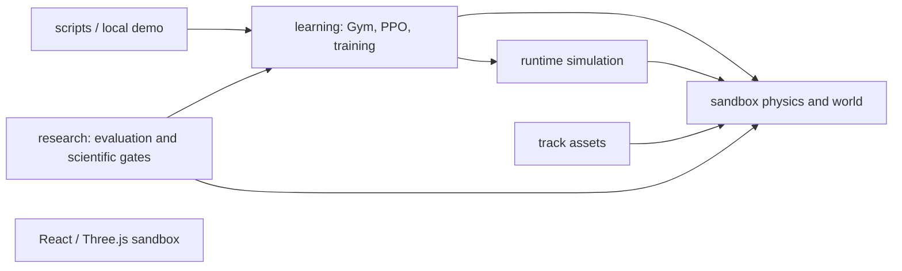

# Dependency map — baseline a909a25

This is a source snapshot, not a scientific certification. The source-backed Archify specification is `baseline-dependency-map.archify.json`; the generated `baseline-dependency-map.html` passed 9/9 artifact checks, but automated browser inspection failed because the available Edge process exited before DevTools inspection. No perceptual review is claimed. Viewer-owned controls use the English fallback.

The web application has no runtime bridge to Python. PPO inference and training use learning and research modules, and research source-bound admission depends on the physical source tree and immutable historical roster/model hashes. `BASELINE-INVENTORY.json` contains the 902 tracked files and exact working-copy hashes at baseline, including 254 Python test files. Immutable evidence paths must not move.

A Python AST import scan shows cross-package import edges: learning → sandbox 64, runtime → sandbox 47, research → learning 39, research → sandbox 33, track_assets → sandbox 24, local_demo → learning 13. Other edges include learning ↔ research, learning ↔ exploratory, research ↔ local_demo and exploratory ↔ research. These are package-level dependency directions, not proof of an import-time module cycle. Dynamic imports and source path strings require separate validation.

Largest modules by lines: `local_demo/campaign.py` 1,237; `sandbox/spatial_contact_dynamics.py` 971; `local_demo/runner.py` 803; `local_demo/evaluation.py` 781; `learning/gym_environment.py` 702. Size alone does not establish a safe split.

Baseline restore/bundle verification passed. Twelve model archives have no literal `f1rl` string in decoded SB3 `data` serialized fields; this is preliminary inspection, not proof that all pickle and binary members are independent of the old package name.
